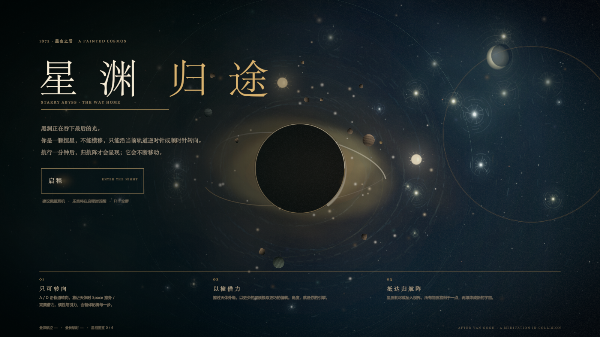

# 星渊 · 归途

一款以梵高《星月夜》为灵感、使用 **Unity 2022.3.62f3c1** 制作的 2D 轨道引力碰撞游戏。

你是一颗恒星，不能横移，只能沿当前轨道逆时针或顺时针转向。借行星、恒星与流星的碰撞抬高轨道，在星穹边界内航行，寻找归航阵。



## 下载

- **Windows 可玩包**：[release/StarryAbyss-Windows.zip](release/StarryAbyss-Windows.zip)
- **Unity 完整工程包**：[release/StarryAbyss-UnityProject.zip](release/StarryAbyss-UnityProject.zip)

Windows 包解压后双击 `StarryAbyss.exe` 即可游玩。  
Unity 工程使用 **Unity 2022.3.62f3c1** 打开。

## 最新版本内容

- 三层星图：内圈尘光带、中圈行星空、外圈归航带。
- 归航阵在前 60 秒隐藏，之后随机显现，每 15–21 秒移动到外环新位置。
- 黑洞周期性进入吸积期：引力增强、盘面变亮、抛出内圈星屑。
- 行星受击会缩小、抛出碎石，多次受击后碎裂成真实碎片。
- 流星雨带落点预警、可躲避，并掉落星屑与临时增益。
- 星屑、连携、航迹分、圈层星屑目标与本地最高纪录。
- 六种随机星相、本地星相图鉴、擦身借力与完美借力。
- 逆流河隐藏事件：连续逆时针绕行三圈可额外选择一次星象。
- 柔和版画面、界面与音效，整体降低饱和度与高光强度。

完整玩法说明见 [zipperproject/README.md](zipperproject/README.md)。

## 仓库结构

```text
zipperproject/        Unity 工程源码（Assets / Packages / ProjectSettings / 截图）
release/              可直接下载的 Windows 与 Unity 资源包
README.md             本说明
```

## 操作

| 按键 | 作用 |
|---|---|
| `A` / `←` | 沿当前轨道逆时针转向 |
| `D` / `→` | 沿当前轨道顺时针转向 |
| `Space` | 擦身 / 完美借力；标题启程；过场跳过；结算下一局 |
| `P` / `Esc` | 暂停 / 继续 |
| `M` | 静音 |
| `V` | 辅助模式 |
| `F11` / `Alt + Enter` | 全屏 / 窗口切换 |

---

*Starry Abyss · The Way Home*

---

## 仓库结构（两个游戏，已分开目录）

| 目录 | 内容 |
| --- | --- |
| `zipperproject/` | **Zipper：海洋与珍珠**（本项目作者制作，Unity 2022.3.62f3c1） |
| `starry-abyss/` | **Starry Abyss 星上归途**（队友制作，Unity 2022.3.62f3c1） |
| `release/` | 星渊归途的发布包与说明 |

两边都在 Unity 2022.3.62f3c1 下开发，互不覆盖。

### 在线试玩（双游戏串联）

https://pine813.github.io/zipperprogect/

- 打通 **Starry Abyss** 后停留 4.5 秒，会自动进入 **Zipper** 第二章
- 直达第二章：`https://pine813.github.io/zipperprogect/?game=b`
- 网页版构建放在 `gh-pages` 分支（首页 + `game-a` + `game-b`）

### 通关跳转怎么实现

`starry-abyss/Assets/Scripts/`：
- `WebBridge.cs` + `Assets/Plugins/WebGL/ZipperBridge.jslib`：WebGL 里向父页面 `postMessage({type:'game-complete'})`
- `ZipperHandoff.cs`：延时器，`ShowEnd()` 里 `result.Escaped` 时调用 `ZipperHandoff.Schedule(4.5f)`
