# 星渊 · 归途

### STARRY ABYSS · THE WAY HOME

一款以梵高《星月夜》为灵感、使用 **Unity 2022.3.62f3c1** 制作的 2D 引力碰撞游戏。

你是黑洞边缘最后一颗恒星。你无法横移，也不能凭空加速，只能让恒星沿当前轨道逆时针或顺时针转向；每一次与行星、陨石和星际尘埃的相撞，都会带走你的一部分星质，也会给你新的方向与速度。镜头跟随你所在的局部星域，左上角小地图替你记住完整的深渊。借碰撞与冲击波抬高轨道，航行一分钟后，星图外环的 **归航阵** 才会显现，并开始不断改变位置。若星质耗尽，或坠入事件视界，万物会被黑洞收拢成一点，然后爆发出下一个宇宙。每局你还会随机获得一种星相，并把首次见到的星相收入本地图鉴。

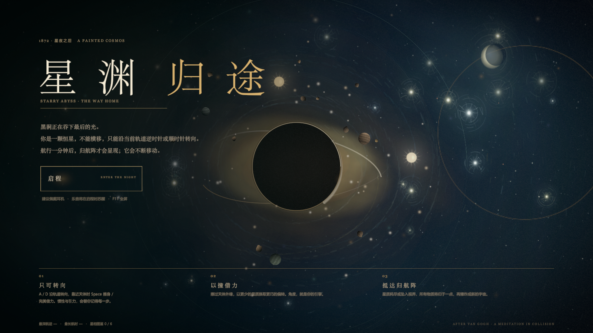

---

## 一、直接游玩

1. 打开 `Build/StarryAbyss/`。
2. 双击 `StarryAbyss.exe`。
3. 进入标题画面后点击「启程」，或按 `Enter / Space`。

- 建议佩戴耳机。
- 默认窗口 1600 × 900，可在窗口右上角最大化；`F11` 或 `Alt + Enter` 可进入/退出全屏。
- 若在另一台电脑运行，请保持整个 `StarryAbyss` 文件夹完整；`StarryAbyss_Data`、`UnityPlayer.dll` 与 exe 缺一不可。

---

## 二、操作

| 按键 | 作用 |
| --- | --- |
| `A` / `←` | 沿当前轨道逆时针转向 |
| `D` / `→` | 沿当前轨道顺时针转向 |
| `P` / `Esc` | 暂停 / 继续 |
| `M` | 静音 / 恢复乐音 |
| `V` | 辅助模式开 / 关 |
| `F11` / `Alt + Enter` | 全屏 / 窗口切换 |
| `Space` | 游玩中：擦身 / 完美借力；标题启程；过场跳过；结算进入下一局 |
| 鼠标 | 标题、暂停与结局画面的按钮 |

> 仍然没有横向变轨，也没有持续推力。`A / D` 只让恒星沿当前轨道选择逆时针或顺时针；速度与轨道能量只由引力、碰撞和擦身借力提供。碰撞仍是改变轨道的唯一主要动力。

### 轨道操作与完美借力

- `A / D` 先把速度方向吸向当前轨道的逆/顺时针切线，对准后保持速度不变；
- 靠近天体时，目标上会出现一圈逐渐收束的金色时机环；
- 在时机环最贴近外圈时按 `Space`：
  - **普通借力**：小额冲量，消耗一次充能；
  - **完美借力**：冲量 +50%，返还本次充能，冷却从 1.1 秒降到 0.65 秒；
- 失败不会额外惩罚，仍可继续尝试。

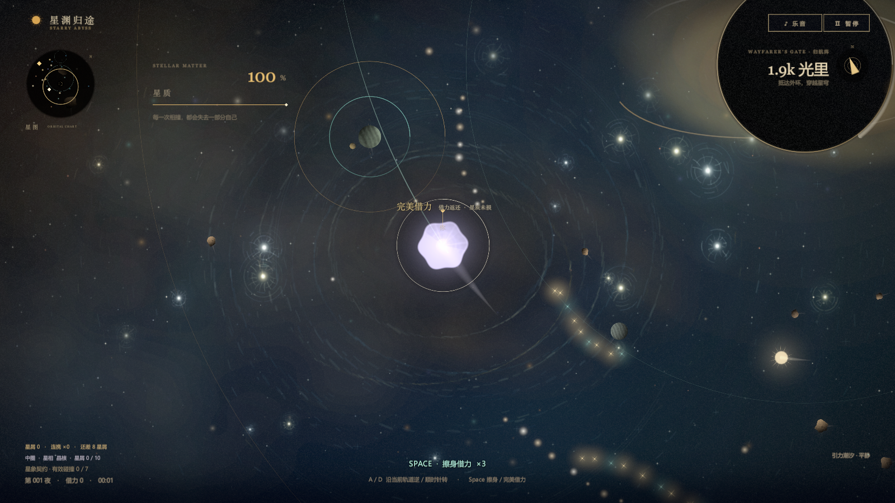

### 星痕与星座

- 擦过大型天体、但没有真正撞上时，会留下一道「星痕」；
- 每次星痕提供航迹分，并在短时间内连成一条轨迹；
- 每 3 道星痕组成一个小星座，奖励航迹分和一次擦身借力；
- 星痕判定在碰撞圈外约 1.15 单位内，必须保持切向擦过，正对撞击不会触发；
- 与大型天体真正相撞会清空已积累的星痕。

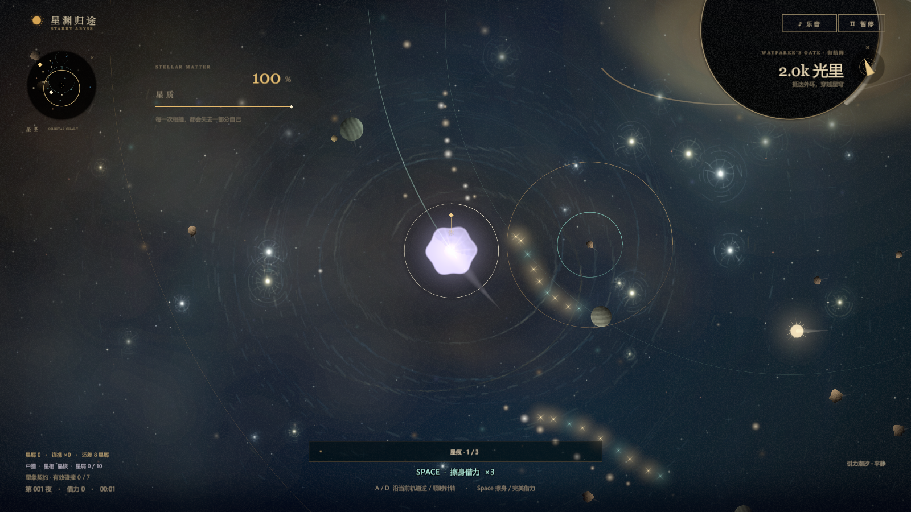

### 行星受击与真实碎片

- 行星被玩家、流星或其他天体撞击后，会按冲量缩小半径与质量；
- 受击会抛出与行星颜色相近的碎石和尘埃，而不是发光的能量球；
- 同一颗行星被多次撞击后，会彻底碎裂成一团沿轨道散开的碎片；
- 碎片仍是真实天体，会继续与行星、恒星和玩家碰撞。

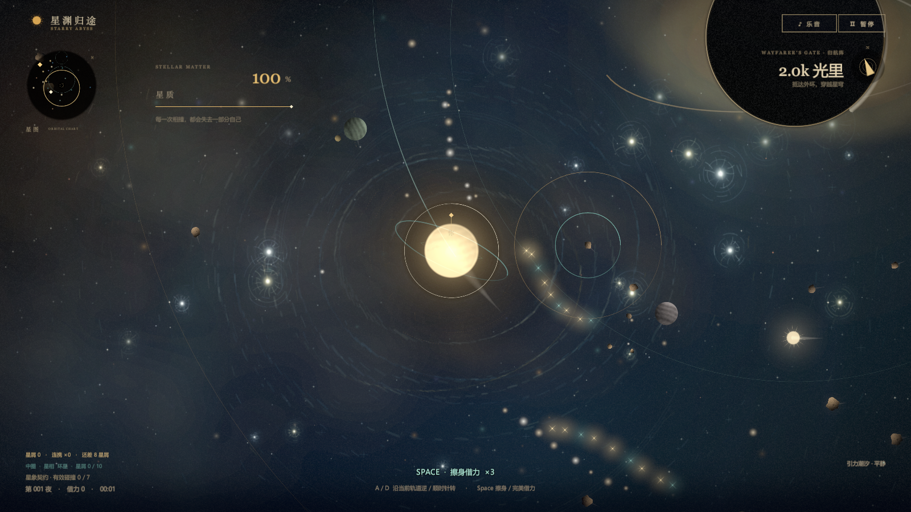

### 黑洞吸积周期

黑洞不再只是背景，而是每约 40 秒完成一次呼吸：

- 安静期约 30 秒；
- 最后 5 秒进入「苏醒」，HUD 右下角会提示；
- 吸积期约 9 秒：引力增加约 12%，盘面变亮，内圈被抛起少量星屑；
- 吸积期每 2.6 秒向外推出一圈引力波，并轻微把附近天体拉向黑洞；
- 吸积期结束后重新安静，循环往复。

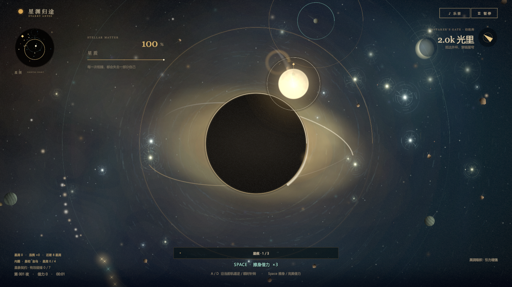

### 更柔和的表现

- 黑洞盘面的硬同心环被替换为连续、低对比度的气体纹理；
- 行星降低饱和度，减少光晕，颜色更接近岩质与气态行星；
- 背景星云、极光与颗粒强度整体降低；
- 撞击、擦身和界面音效音量下调，HUD 操作提示在开局 20 秒后自动淡出。

### 归航阵：航行一分钟后显现

- 前 60 秒，归航阵完全隐藏，小地图没有金色菱形，罗盘不指向它；
- 右上角显示 `59 秒后显现` 的倒计时；
- 满 60 秒后，归航阵在外环随机位置出现，HUD 切换为实际距离与方向；
- 之后每 15–21 秒随机移动到外环的新位置；
- 移动前 3 秒会提示 `归航阵正在移动`；
- 如果玩家距离归航阵小于 5.2 单位，它会暂时等待，避免在玩家眼前瞬移；
- 归航阵显现前无法触发归航，显现后靠近即可进入。

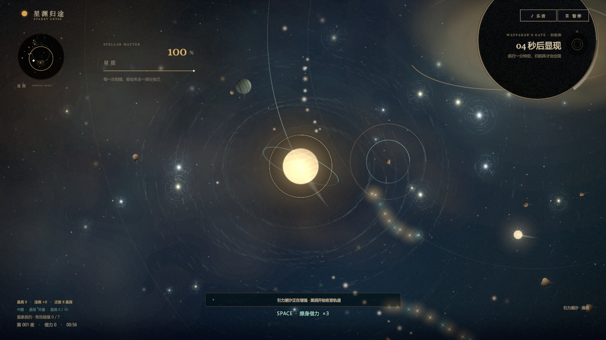

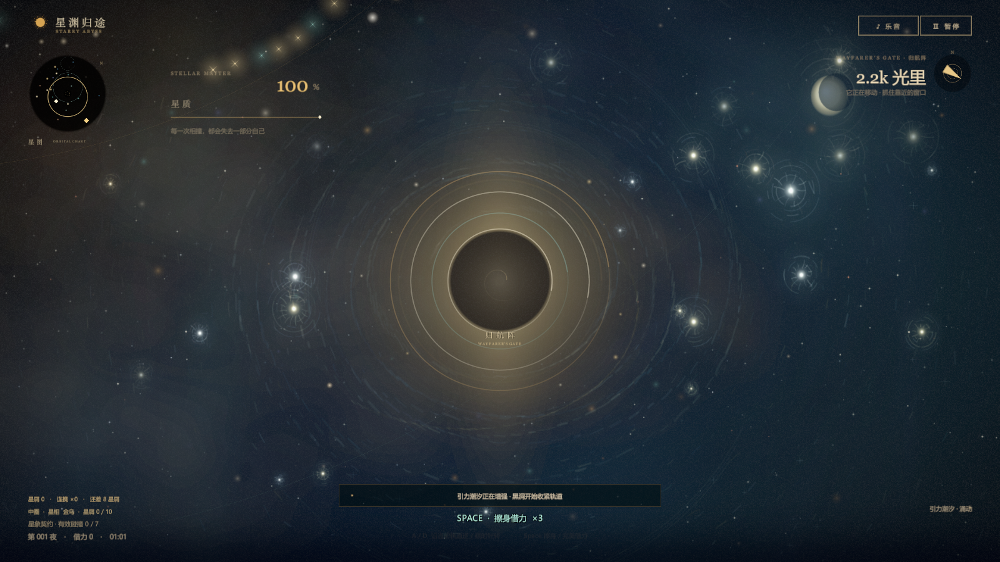

## 三、核心规则

- **相撞借力**：接触点相对天体中心的方向决定冲量方向。擦过外侧，转向灵巧、星质消耗更少；撞得越正，冲量越重，损耗也越大。
- **星质**：初始 100%。每次撞击损失一部分；HUD 左侧与角色外圈会同步变化，恒星主体也会随星质减少而明显收缩。星质为 0 时，会进入湮灭过场。
- **物质创生**：恒星相撞会留下行星；行星相撞会留下陨石；陨石相撞会留下星尘。相撞还会迸出颗粒、冲击波和光屑，并把附近天体推开，可能引发连锁撞击。
- **归航阵**：星图外环上的金色传送阵。航行满 60 秒后才会显现；之后每 15–21 秒随机移动到外环的新位置，靠近玩家时会延迟移动。抵达即“归航”，进入下一片星夜。
- **星穹边界**：外环是封闭的。归航阵是唯一出口；撞上星穹边界会被弹回。
- **黑洞潮汐**：游戏时间越久，引力潮汐越强。本版放缓了潮汐增长，并把提醒推迟到 65 / 125 / 185 秒，让一局能稍微多撑一会儿。
- **三层星图**：禁区半径扩至 21.5，归航阵在外圈 20.0。黑洞到外环被分为三层：
  - **内圈 · 尘光带**（1.8–7.2）：物质最小、最稀疏，以星尘和微陨石为主；
  - **中圈 · 行星空**（7.2–14.2）：行星、陨石与少量恒星，玩家从这里启程；
  - **外圈 · 归航带**（14.2–21.5）：天体最大、最密，恒星与带环巨行星守在归航阵前。
  每层内部还有约 15% 的“越界天体”以偏心轨道穿过边界，避免三层变成三条死板的环。
- **局部星图**：镜头跟随你所在的区域，中央黑洞、归航阵与大部分星域都不再同时挤在屏幕上。左上角小地图会标出黑洞、你和附近天体；归航阵显现后才会出现金色菱形标记。左下角会同步显示当前圈层。
- **轨道预览**：恒星周围那条淡色曲线是当前轨道的未来几秒预览。它不会推演碰撞，但能帮你看清松开按键后会飘向哪里。
- **循环**：过场结束后，新宇宙主题会轮换（星夜 / 新宇宙 / 月潮 / 琥珀）。坚持越久、航迹越深，记录会保存在本机。

### 星相与星相图鉴

每次启程，你会随机成为六种星相之一；外观、星体纹理、光环颜色都不同：

- **金乌**：金色日冕与细密米粒组织；
- **苍蓝**：蓝白恒星与冷色耀斑；
- **赤烬**：暗红恒星、黑子与裂纹；
- **环星**：带一圈倾斜光环的暖色恒星；
- **晶核**：多面晶体星核与棱面反光；
- **月潮**：青白恒星，带一颗绕行的小伴星。

HUD 左下角会标出本局星相。首次遇到的新星相会录入本地「星相图鉴」，标题画面底部显示收集进度（例如 `星相图鉴 3 / 6`）；重复遇到不会丢失。

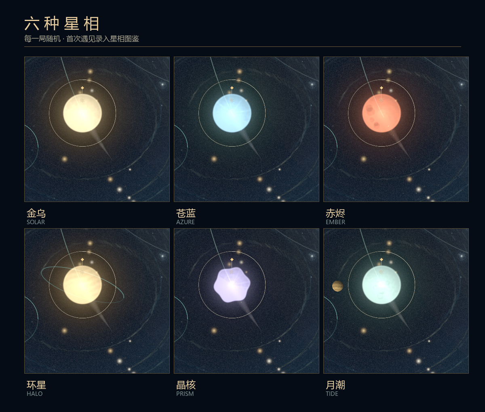

### 随机事件 · 流星雨

游戏时间每到 **2 分钟**，星场会先出现 4 秒预警，随后从外环射入一波 **13–17 颗流星**，瞄准途中的行星、恒星或玩家。

- 预警阶段会在 **玩家与两个大型天体**周围出现旋转的珊瑚色/金色落点圈；玩家可以提前离开红圈躲避；
- 流星是真实天体，会与行星、恒星发生碰撞，也会被黑洞吞没；
- 行星被击中会弹开、迸出碎屑，并可能引发连锁撞击；
- 流星撞击会掉落 **星屑**，第一次撞击还会触发 **14 秒流星余辉**：擦身借力 +1、撞击冲量 +18%；
- 流星雨每 2 分钟重复一次，从“纯惩罚”变成可预警、可躲避、有掉落的随机事件。

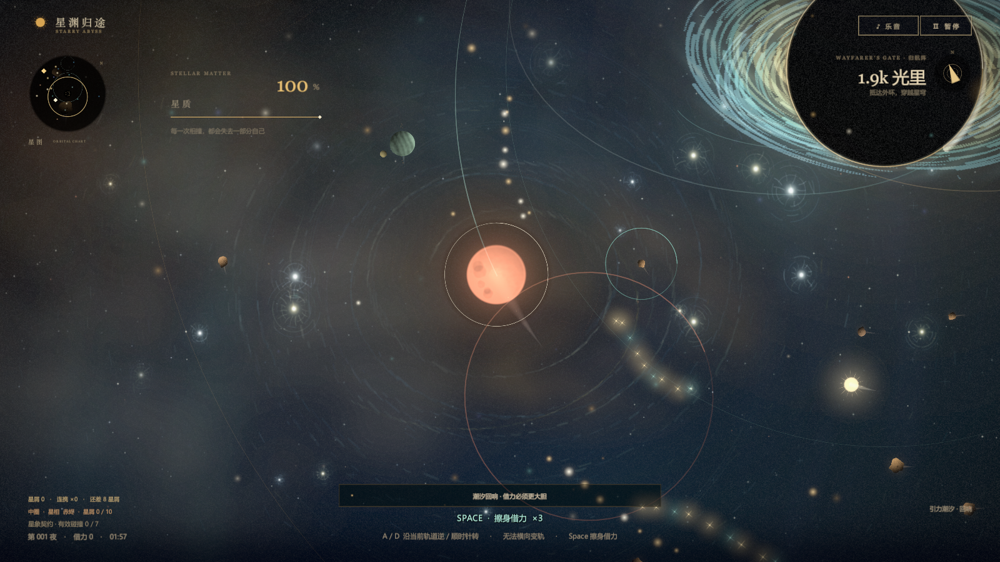

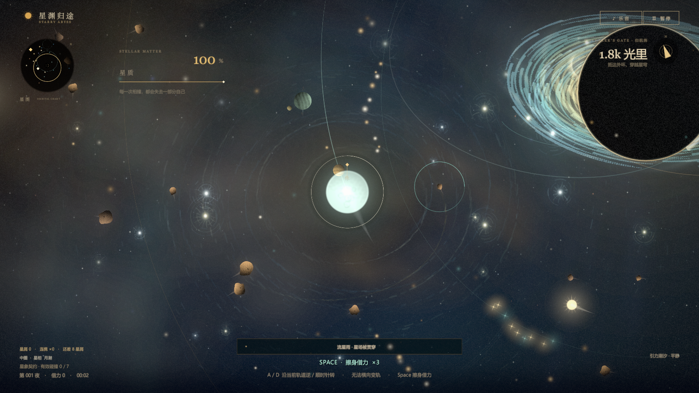

### 隐藏星轨 · 逆流河

游戏里的天体默认顺时针公转。若你连续 **逆时针（A 方向）绕黑洞超过 3 整圈**，会触发隐藏事件「逆流河」：

- 时间短暂停滞，星象契约以青色字幕再次出现；
- 你可以 **再选一次技能**，这次选择不消耗第 7 次有效碰撞的正常契约；
- 每局只能触发一次；中途改变方向、被撞反或坠入黑洞都会重置逆流计数；
- 开始逆行后，恒星外会出现一圈 **淡青色逆流进度环**，满一圈约三分之一；第 1、2 圈会有轻提示，方便发现这个彩蛋。

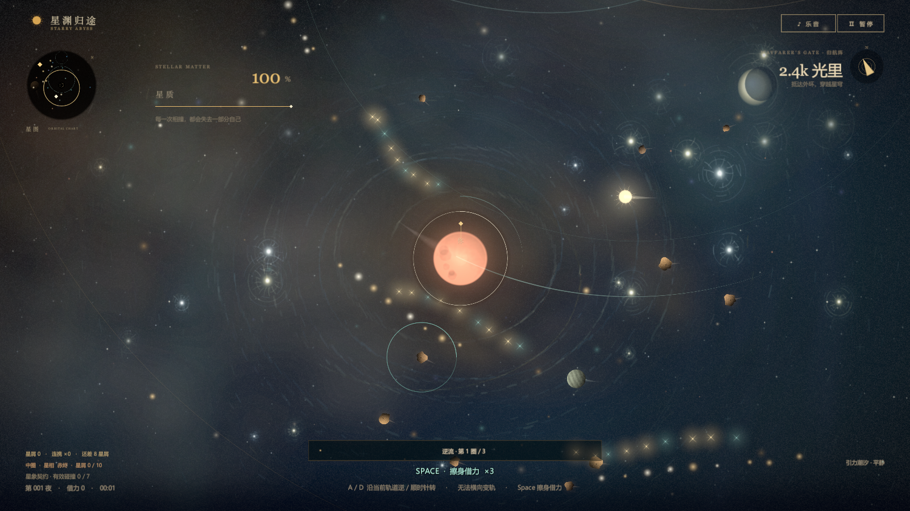

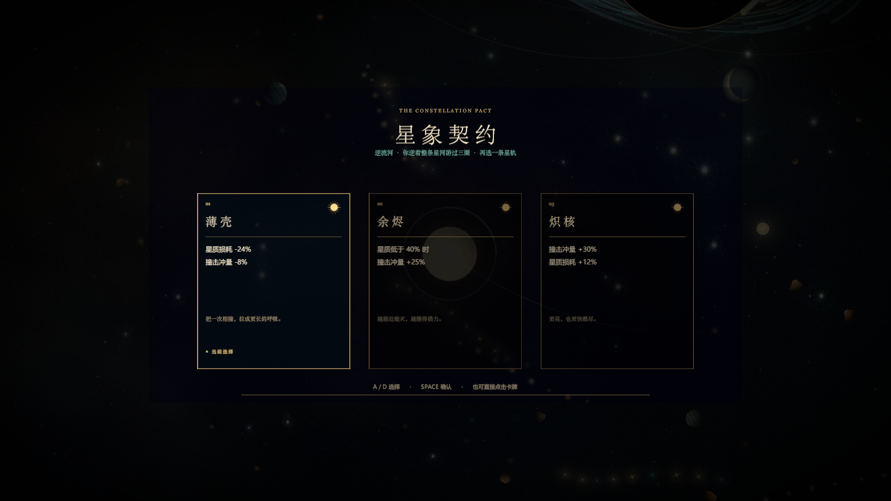

### 星屑共鸣

星图上会漂浮一圈圈金色/青色星屑。本版把同时存在的星屑上限提高到 50，并把补充间隔从 1.35 秒略缩短到 1.2 秒；星屑仍然有限，也不会参与碰撞，但补给比上一版宽松一点。它们会被引力带动，也会被黑洞吞没。

- 靠近星屑即可拾取；连续拾取会累积 **连携**，连携越高，每枚星屑提供的星屑值越多。
- 每累积 **8 点星屑**触发一次「星屑共鸣」，每局最多 **4 次**：
  - 补给：星质 +4，擦身借力 +1；
  - 护盾：展开一圈星辉护盾，下一次大型碰撞的星质损耗降至 **35%**。
- 与陨石/行星/恒星相撞会中断连携；与星尘无关。
- 4 次共鸣之后，星屑不再提供补给，但每枚都会转化为 **航迹分**；连携越高，单枚航迹分越高。HUD 会从“还差 X 星屑”切换为“航迹分”。
- 每个圈层还有一个 **可选星屑目标**：内圈 4、中圈 10、外圈 14。只在当前圈层收集才计数；完成后奖励航迹分、星质与一次擦身借力。星相行会显示当前圈层的 `星屑 n / 目标`。
- 每局的航迹分会显示在结算画面，并保存本地最高纪录。

这让每一段航程都多了一个主动目标：是沿现有轨道去撞天体借力，还是绕去追一串星屑，换取回血、额外借力、护盾或航迹分。

本版同时把玩家撞击的基础星质损耗下调约 8%，让一次失误不至于立刻结束一局；核心规则仍然是碰撞、借力与归航。

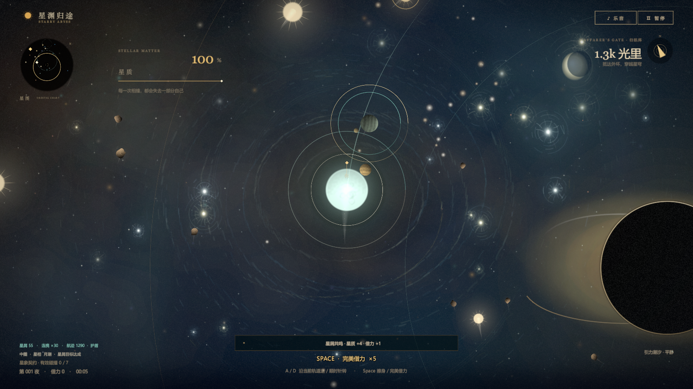

### 三层星图

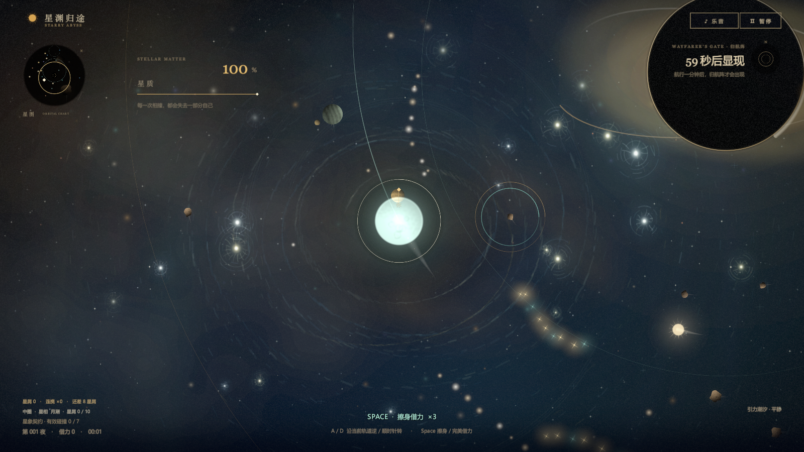

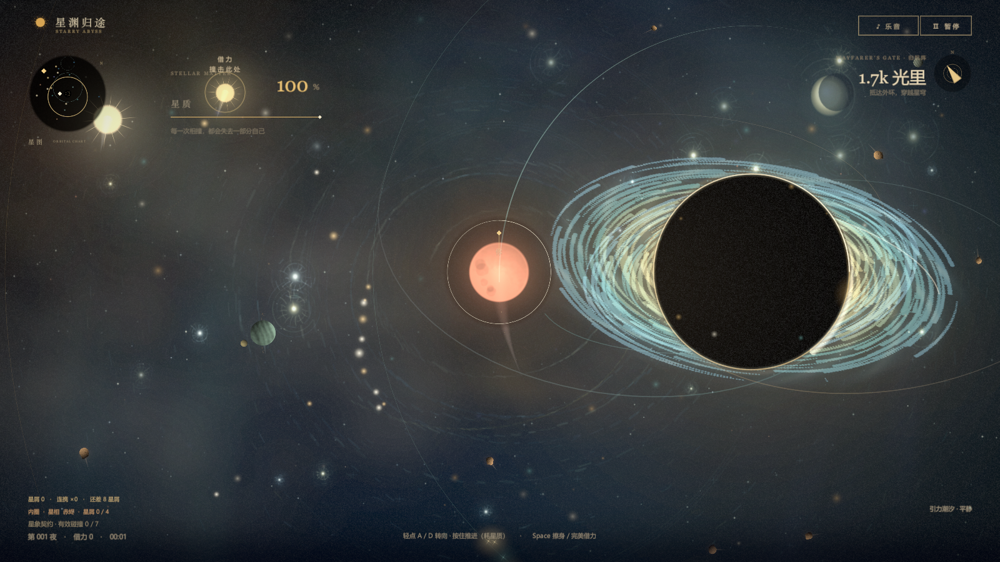

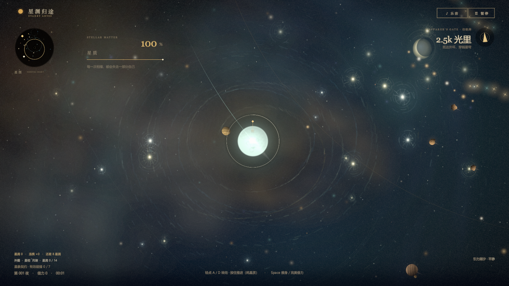

### 星象契约

每局第 **7 次有效碰撞**之后，时间会短暂停下来，给出三张星象牌，只能选择一张；这是本局唯一一次契约。有效碰撞指与陨石、行星或恒星相撞，掠过星尘不计入。契约只在本局生效，牌池中的同一项不会重复出现。画面左下角会显示“有效碰撞 n / 7”的进度。

- **炽核**：撞击冲量 +30%，星质损耗 +12%。
- **薄壳**：星质损耗 -24%，撞击冲量 -8%。
- **回声**：冲击波推力 +55%，波及更远。
- **拾光**：立即回复 18 星质，此后撞击冲量 -6%。
- **潮汐低语**：潮汐增长 -30%。
- **余烬**：星质低于 40% 时，撞击冲量 +25%。

用 `A / D` 选择，`Space / Enter` 确认，也可以直接点击卡牌。它把“碰撞”从随机事件变成了可以被构筑的策略：这一局是做一颗更炽烈、更耐撞的星，还是让星潮推着天体走，由你决定。

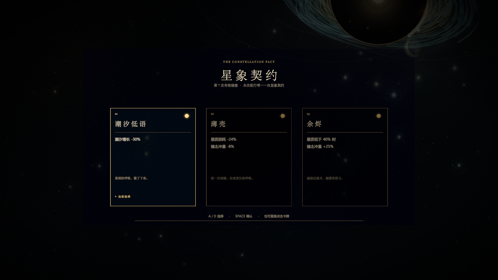

星质消耗会直接反映在恒星主体上：24% 星质时，恒星的实心星核、光晕、尾迹与星质环都会明显收缩。

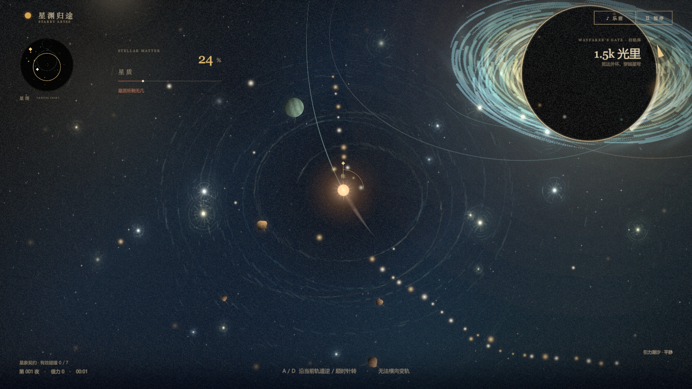

### 擦身借力

靠近陨石、行星或恒星、但还没有真正撞上时，目标天体会出现一圈青色窗口环，画面下方会出现 `SPACE · 擦身借力 ×3` 的提示。

- 每局 **3 次**，冷却 1.1 秒，不消耗星质。
- 获得一小段顺行推力，并稍微远离目标天体，用来主动制造或避开下一次碰撞。
- 不算“有效碰撞”，不会计入星象契约的 7 次进度。
- 它不能横移，只是给轨道一个有限的调整窗口；
- 时机环收束到最贴近时按下，可触发 **完美借力**：额外冲量、返还充能并缩短冷却。

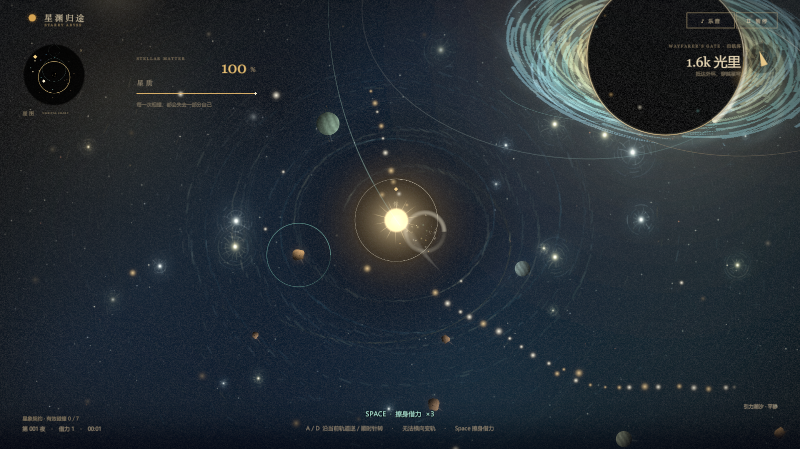

### 辅助模式

按 `V` 或暂停菜单的「辅助模式」打开。设置会保存在本机，下次启动延续。

- **更长的轨道预测**：预测线从约 5 秒延长到约 9 秒。
- **最近交会点**：预测路径上最接近大型天体的位置会出现一枚金色圆环，提前判断该不该继续沿这条轨道走。
- **柔和转向**：转向速度降低约 18%，屏幕震动减弱，适合想慢一点观察轨道的玩家。

辅助模式不会改变实际物理，只是把原本隐藏在未来的信息显示出来。

### 关于“角度”

`A / D` 会把速度方向吸向当前轨道的逆/顺时针切线，但不会增加或减少速度。它不能直接横移，也不能自由加速；想改变高度和偏心率，必须借天体碰撞与擦身借力的冲量。观察小地图、轨道预览和附近天体的相对位置，选择在轨道的哪一侧、以哪个方向迎接碰撞。

---

## 四、视听设计

- **画面**：所有背景、星空晕环、吸积盘、归航阵、天体、UI 纹样与光晕由代码生成，不使用外部图片。四张主题背景由随工程附带的程序化绘画笔刷烘焙而成；其上加绘七层程序化星云、两幅竖向极光、58 颗彩色闪烁星、周期性流星，并随内/中/外圈层缓慢换色。本版新增全屏柔光薄雾、降低颗粒强度，并减弱碰撞闪光、震屏与危险红晕，整体更柔和。
- **黑洞**：倾斜的动态吸积盘、软边事件阴影、内缘热斑、双层冷暖吸积薄纱、光子环与局部新月、引力透镜弧、旋臂、坠落光点与潮汐脉动实时绘制，不再是生硬的黑色圆盘加同心线。
- **星图**：再次扩大的局部引力场——内圈尘光带、中圈行星空、外圈归航带分层布置，镜头跟随玩家所在的局部视角。物质由近到远依次增大：越靠近黑洞越细小稀疏，越靠近归航阵越巨大密集；15% 的越界天体让三层互相穿插。左上角小地图负责完整空间感，外环仍有一道极淡的边界环。
- **天体变化**：行星表面新增六类程序化风貌（荒漠、气态、冰原、海洋、晶簇、陨坑），部分行星带环，部分大行星与恒星带绕行小卫星；每局恒星还会随机获得一种星相，并在同星相内随机化色温、光环倾角与伴星相位。
- **碰撞反馈**：屏幕震动、短暂顿帧、全屏光闪、双层冲击波、拉伸粒子、星形碎屑颗粒、漂浮“借力”文字、按撞击重量分层的合成音效；重击还会把附近天体推开。
- **轨道读法**：淡色轨道预览、逆/顺时针提示和局部小地图共同构成新的导航层。
- **音乐**：无需音频素材。运行时合成一场带有混响回声的“毡音钢琴”小夜曲：D 大调九和弦与 B 小调、G 大调、A 属和弦循环；琶音、单音旋律、低音与铺底分层出现。黑洞吸积声、归航阵的嗡鸣、相撞的低频与碎光声也全部是程序化合成。
- **结局音色**：大爆炸去掉了尖锐的噪声起音，改为低通后的低频轰鸣；归航和弦整体降低八度并放慢起音。结算画面落下一层温暖的“尾声”和弦，而不是骤然静默。
- **过场**：万物向心坠落 → 收束成点 → 大爆炸 → 新宇宙星尘 → 下一轮。抵达归航阵时，镜头会推入金色门扉。


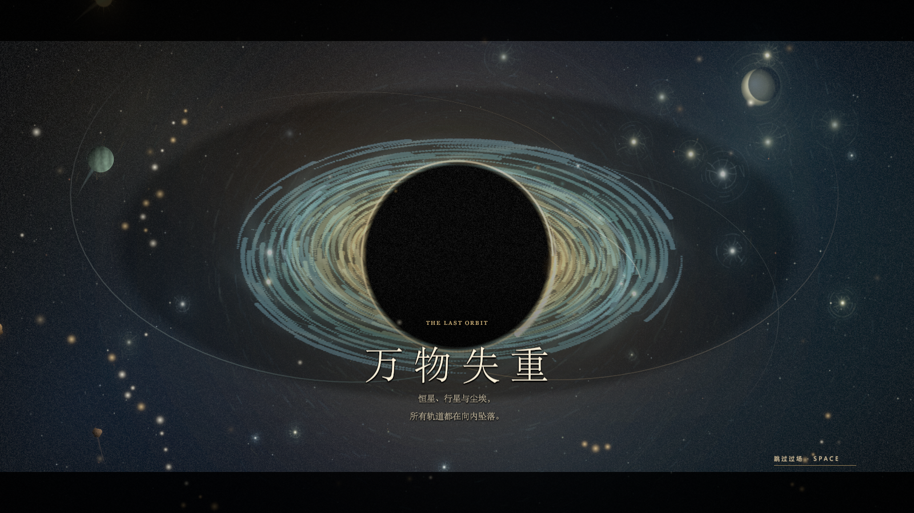

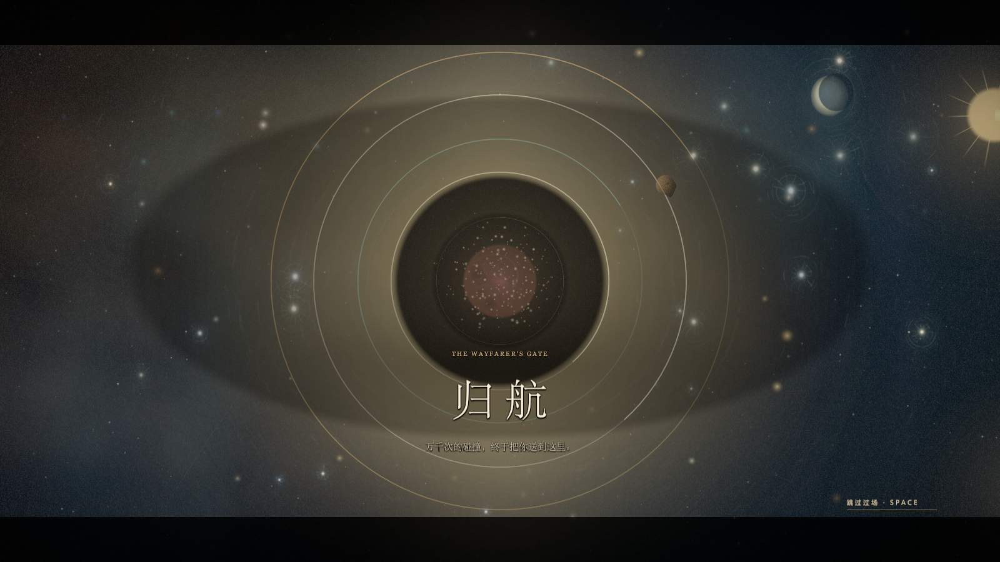

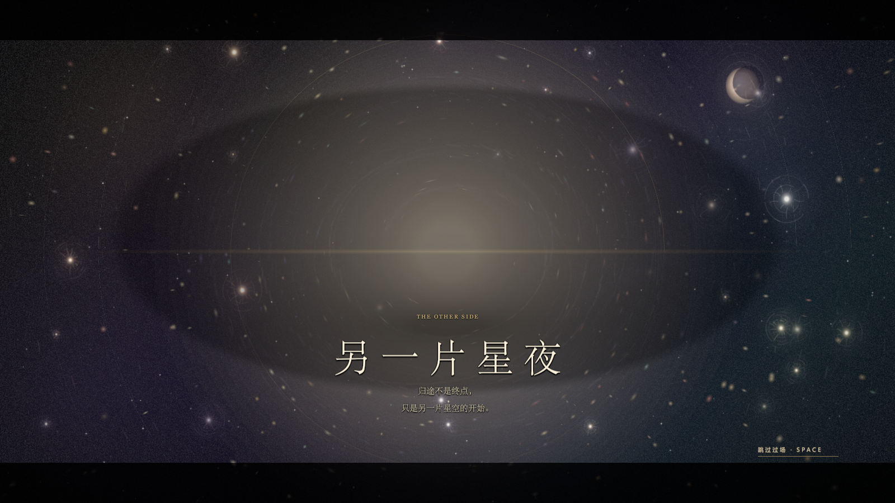

---

## 五、工程结构

```text
StarryAbyss/
├─ Assets/
│  ├─ Scenes/Main.unity             # 故意保持空场景；运行时自举
│  ├─ Scripts/
│  │  ├─ StarryGame.cs              # 游戏状态机、物理、碰撞、过场
│  │  ├─ StarryUI.cs                # 运行时构建的全部界面
│  │  ├─ WorldVisuals.cs            # 黑洞、归航阵、天体、玩家、粒子视图
│  │  ├─ ProceduralArt.cs           # 程序化贴图与 UI 精灵
│  │  ├─ StarPalette.cs             # 四套主题色
│  │  ├─ StarryAudio.cs             # 程序化钢琴、环境声与碰撞音效
│  │  └─ Models.cs                  # 数据模型
│  ├─ Resources/Art/                # 四张烘焙天空
│  ├─ Resources/Starry/Additive.shader
│  └─ Editor/                       # 构建脚本与贴图导入规则
├─ Build/StarryAbyss/               # 可直接运行的 Windows 版本
├─ Screenshots/                     # 开发期实机截图
├─ Tools/BackgroundBaker/           # 生成四张天空的 HTML/JS 笔刷工具
└─ README.md
```

- 入口：`StarryGame.Boot()` 通过 `[RuntimeInitializeOnLoadMethod]` 创建整个游戏，不依赖预制体、场景对象或手工拖拽引用。
- 字体：运行时读取系统字体（优先华文宋体 / 思源宋体 / 宋体，正文回退微软雅黑 / 黑体）。因此不同电脑上的字形可能有细微差别。
- 分辨率：UI 以 1920×1080 为参考分辨率等比缩放。

---

## 六、在 Unity 中打开与重建

1. 使用 Unity Hub 以 **Unity 2022.3.62f3c1** 打开本文件夹。
2. 打开 `Assets/Scenes/Main.unity`，直接按 Play。空场景是正常的，游戏会在运行时出现。
3. 重新打包：菜单 **Starry Abyss → Build Windows Player**，产物写入 `Build/StarryAbyss/`。

命令行构建：

```powershell
& "D:\unity\unity Editor\2022.3.62f3c1\Editor\Unity.exe" `
  -batchmode -quit -nographics `
  -projectPath "D:\deep seek\deepseek\StarryAbyss" `
  -executeMethod StarryAbyss.EditorTools.StarryBuild.BuildWindows `
  -logFile "D:\deep seek\deepseek\StarryAbyss\Build\build.log"
```

---

## 七、素材与说明

- 本作不是对《星月夜》的复制，而是一次以星夜为视觉语法的原创程序化创作。
- `Tools/BackgroundBaker/` 是四张背景天空的绘制来源。浏览器打开 `bg-bake.html?theme=0&seed=92731` 可重新渲染主题 0，`theme=1..3` 对应另外三套宇宙。
- 本工程不依赖任何第三方美术、音频或商业插件。
- 若音频设备初始化失败，游戏会自动继续运行（静音），不会影响操作与结局。
- 所有过场与结算均为实时生成；无视频文件。

---

*“归途不是终点，只是另一片星空的开始。”*
